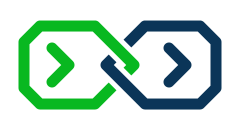
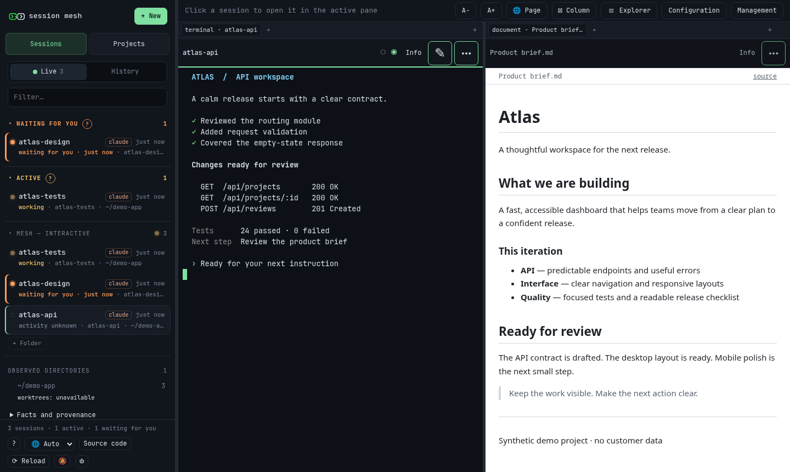
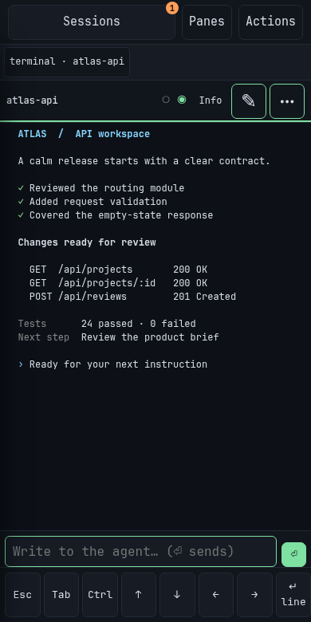
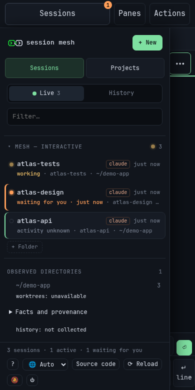
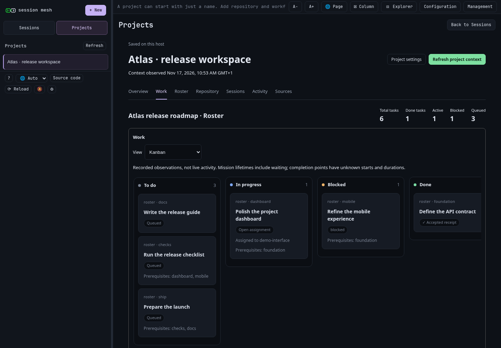

  <picture>
    <source media="(prefers-color-scheme: dark)" srcset="docs/images/logo/session-mesh-dark.svg">
    
  </picture>

# session-mesh

session-mesh is a web interface for running and watching terminal sessions and coding agents on
your own Linux or macOS machine. It lists every session with the agent running in it and whether it
is busy or waiting for you, and shows the live terminals side by side, from a desktop browser or a
phone. It runs as your user and listens on `127.0.0.1` only; your other devices reach it through an
SSH tunnel, Tailscale or a VPN.

<table>
  <tr>
    <th colspan="2">On a phone</th>
  </tr>
  <tr>
    <th>A terminal</th>
    <th>The session list</th>
  </tr>
  <tr>
    <td></td>
    <td></td>
  </tr>
</table>

**Status: alpha.** Built for one person on one machine; expect behaviour changes between versions
([CHANGELOG.md](CHANGELOG.md)). Release bundles exist for Linux x86_64, Linux arm64 and macOS on Apple silicon (best effort).

## What you can do with it

- **Start and follow agents.** Claude Code, Codex, Pi, OpenCode, Gemini CLI, Antigravity, GitHub
  Copilot CLI and Mistral Vibe, or a shell or any command, each in a session that survives a restart
  of the web server. The sidebar shows which ones wait for you; agents in other terminals are listed
  too ([agents.md](docs/agents.md)).
- **Find past conversations.** The History tab lists the conversations of all eight agents by
  folder, with full-text search, and resumes one in the mesh.
- **Read documents beside the terminals.** Markdown, HTML, PDF, images and source files open in a
  column; `mesh-open FILE` lets an agent show what it has just written. Open only HTML documents you
  trust ([why](SECURITY.md#documents-that-send-data-out)).
- **Let agents work together.** A whiteboard and demos per session, and messages between agents,
  which are read only with your consent.
- **Keep track of projects.** The Projects mode groups a project's folders, repository and, when you
  turn it on, what its Git repository and its roadmap say (a roadmap kept with
  [Roster](https://github.com/mathiasbourgoin/roster), the pipeline this project is developed with).
- **Use it from a phone.** One column, a session drawer, a key bar for Esc, Tab, Ctrl and arrows, and
  optional push notifications when an agent finishes or waits for you.

The interface is in English or French. Every feature is described in
[docs/features.md](docs/features.md).

## Install

On Linux with a systemd user session, download a release's `install.sh` and `SHA256SUMS` from the
[releases page](https://github.com/Session-Mesh/session-mesh/releases), check the installer with
`sha256sum -c --ignore-missing SHA256SUMS`, and run `bash install.sh`. The release bundle brings its
own Python and Node; open the URL it prints and paste the token. The full procedure, macOS, a source
install and remote access are in [docs/install.md](docs/install.md).

## Documentation

- [Installing](docs/install.md) and [configuring](docs/configuration.md) session-mesh
- [Supported agents](docs/agents.md) and [features](docs/features.md)
- [Operations](docs/operations.md): upgrades, restores, HTTPS through a reverse proxy, removal
- [Security](SECURITY.md): session-mesh gives whoever holds the token a shell as your user; read
  the threat model before exposing it, and report vulnerabilities privately as described there
- [Contributing](CONTRIBUTING.md) and [development](docs/development.md)
- [All documentation pages](docs/README.md)

## License

session-mesh is free software under the GNU Affero General Public License, version 3 or (at your
option) any later version (AGPL-3.0-or-later); see [LICENSE](LICENSE) and [NOTICE](NOTICE).
Copyright (c) 2026 Atacama (https://atacama.tech, contact@atacama.tech) and the session-mesh
contributors ([CONTRIBUTORS.md](CONTRIBUTORS.md)). Contributions are accepted under a contributor
license agreement ([CLA.md](CLA.md)) that also lets Atacama, and only Atacama, relicense the project
later, while every distribution of a contribution stays available under the project's license in
force when it was made ([details](CONTRIBUTING.md#contributor-license-agreement)). Third-party files
keep their own licenses: [static/vendor/THIRD_PARTY.md](static/vendor/THIRD_PARTY.md),
[LICENSES/](LICENSES/), and the MIT license of the code `history.py` adapts, reproduced in
[NOTICE](NOTICE). If you run a modified version for other people over a network, point its "Source
code" link at your source ([how](docs/configuration.md#the-source-code-link)).

session-mesh is an independent project. It is not affiliated with or endorsed by Anthropic (Claude
Code), OpenAI (Codex), Tailscale, or the makers of Pi and of the other tools and libraries it names;
their names and marks belong to their owners.

Developed with [Roster](https://github.com/mathiasbourgoin/roster).
